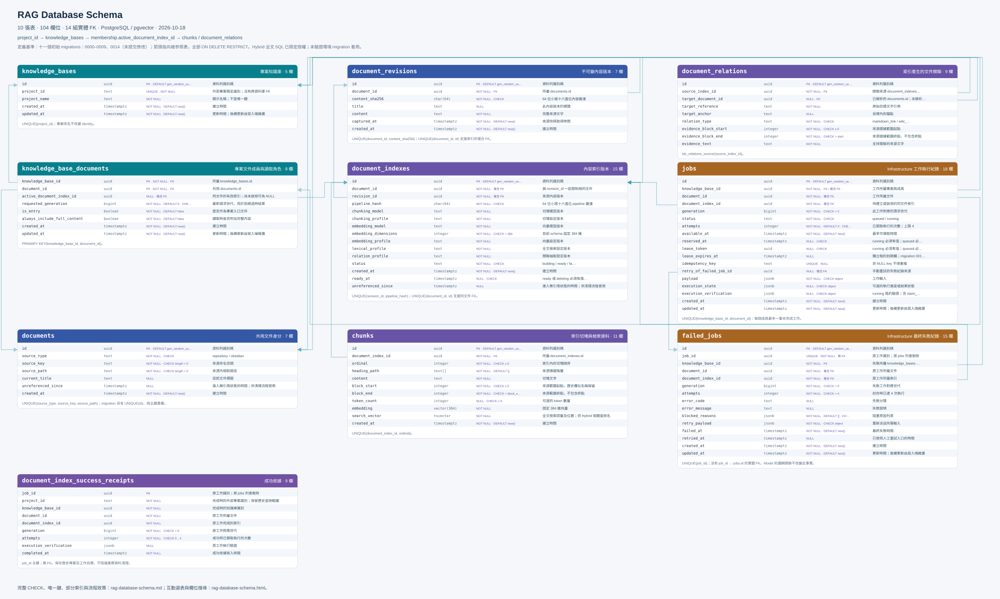
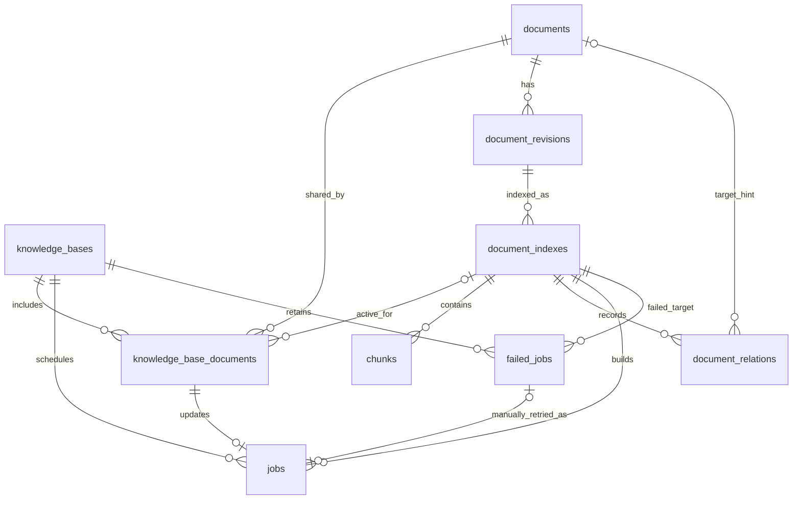

# 獨立 RAG Database Schema 草案

> Draft v4 · 2026-10-12 · 僅供設計審閱，尚未建立資料庫或套用 migration。

[互動版資料字典](./rag-database-schema.html) · [agent-teams 執行待辦](../../../agent-teams/docs/TODO.md)

## 部署與邊界

- 新資料庫名稱建議 agent_teams_rag，使用獨立 PostgreSQL instance／服務與資源配置、連線池及帳號。只在原本 instance 新建 database，仍會共用 CPU、記憶體與 I/O，不能達到完整負載隔離。
- RAG 查詢 UseCase 與背景索引 worker 共用這個資料庫；業務資料庫保留任務、執行、狀態與 Plan。跨庫以 project_name 邏輯對應，不建立跨資料庫 FK；改名時更新對應名稱，RAG 內部關聯始終使用 knowledge_bases.id。
- 第一版一個專案對應一個 knowledge_base。knowledge_base_documents 讓知識庫與共用文件形成多對多；共享原文與相容索引，但檢索範圍、入口／必要全文角色及每份文件的有效索引由各專案獨立管理。
- 這是全新資料庫草案，不沿用舊 knowledge_chunks 的欄位或 ID 相容限制。本文尚未套用 migration，也未建立實際資料庫。

## 文件共用關係

`knowledge_bases` 與 `documents` 是多對多：每個專案可以使用多份文件，同一份文件也可以被多個專案共用。`knowledge_base_documents` 同時保存文件角色與該專案目前使用的完整索引。

例如 A、B 專案共用「分層目錄.md」：只保留一個 document，建立兩筆成員。來源版本與完整 pipeline_hash 相同時共用 document_index 及 chunks；入口／必要全文角色與有效索引指標仍由各專案管理。

查詢路徑：`project_name → knowledge_bases → knowledge_base_documents.active_document_index_id → document_indexes → chunks`。每份文件獨立更新；不保證多份文件同時切換，也不保存歷史的整個專案文件版本集合。

## 資料責任

| 資料表 | 用途 |
| --- | --- |
| `knowledge_bases` | 識別使用 RAG 的專案；各專案的文件範圍、讀取角色與有效索引由成員表管理。 |
| `knowledge_base_documents` | 建立專案與共用文件的多對多關聯，保存入口／必要全文角色，並逐份文件切換已完成的有效索引。 |
| `documents` | 保存可跨專案共用的文件身分與來源；文件不隸屬單一知識庫，內容變更不改文件身分。 |
| `document_revisions` | 保存共用文件的不可變全文版本；多個專案可以引用同一版本，也可暫時使用不同版本。 |
| `document_indexes` | 保存文件版本經特定處理設定產生的索引；文件版本與完整處理設定相同時，多個專案直接共用。 |
| `chunks` | 保存全文上下文切割的原文語意段落；跟隨共用 document_index，不為每個專案重複儲存。 |
| `document_relations` | 保存共用文件索引中有原文依據的關係；查詢時依專案的文件成員與各自有效索引解析及擴展目標。 |
| `jobs` | 排程單一專案文件的增量更新；首次執行失敗後自動重試 3 次，成功即刪除，重試耗盡則原子移入 failed_jobs 並刪除 jobs。 |
| `failed_jobs` | 保存首次執行及 3 次自動重試皆失敗的工作；歸檔後原 jobs 已刪除，人工重試另建工作並保留失敗紀錄。 |

## 工作佇列與重試規則

參考 [既有 database-schema 的 jobs／failed_jobs](database-schema.html) 沿用 attempts、reserved_at、idempotency_key、payload、execution_state、execution_verification 與 retry_payload 命名。RAG 保留自己的專案／文件／索引關聯，不加入業務任務專用的 task_id、role、workspace_id、model_assignment_id 或 dependencies；本版僅使用 queued／running 狀態。新庫使用 uuid、timestamptz 與 jsonb，並非直接複製既有表的 text 型別。

| 執行情況 | attempts | jobs | failed_jobs |
| --- | --- | --- | --- |
| 首次執行失敗 | 1 | 保留原 ID，等待第 1 次自動重試 | 不新增 |
| 第 1 次自動重試失敗 | 2 | 保留原 ID，等待第 2 次自動重試 | 不新增 |
| 第 2 次自動重試失敗 | 3 | 保留原 ID，等待第 3 次自動重試 | 不新增 |
| 第 3 次自動重試仍失敗 | 4 | 同一 transaction 刪除 | 同一 transaction 新增失敗紀錄 |
| 任一次執行成功 | 1–4 | 啟用完整索引後刪除 | 不新增 |
| 人工重試失敗紀錄 | 重設為 0 | 建立新 ID，適用新的首次＋3 次自動重試 | 保留原紀錄，更新 retried_at／updated_at |

## 欄位規格

以下型別與約束為提案，不是可直接執行的 DDL。未標為 NULL 的欄位均為必填；PK 欄位隱含 NOT NULL。

### knowledge_bases — 專案知識庫

識別使用 RAG 的專案；各專案的文件範圍、讀取角色與有效索引由成員表管理。

| 欄位 | 型別 | 約束 | 用途 |
| --- | --- | --- | --- |
| `id` | `uuid` | PK | RAG 自有識別碼 |
| `project_name` | `text` | UNIQUE / NOT NULL | 業務系統的專案名稱；僅邏輯對應，沒有跨資料庫 FK |
| `created_at` | `timestamptz` | NOT NULL | 建立時間 |
| `updated_at` | `timestamptz` | NOT NULL | 更新時間 |

- UNIQUE(project_name)：第一版假設此服務內專案名稱唯一；專案改名只更新名稱對應，保留同一個 id。
- 一個 knowledge_base 對應一個專案；透過 knowledge_base_documents 選擇可檢索文件，不直接擁有共用文件內容。

### knowledge_base_documents — 專案文件成員與有效索引

建立專案與共用文件的多對多關聯，保存入口／必要全文角色，並逐份文件切換已完成的有效索引。

| 欄位 | 型別 | 約束 | 用途 |
| --- | --- | --- | --- |
| `knowledge_base_id` | `uuid` | PK part / FK | 使用此文件的知識庫 |
| `document_id` | `uuid` | PK part / FK | 被此知識庫使用的共用文件 |
| `active_document_index_id` | `uuid` | NULL, FK | 本專案目前使用的完整文件索引；首次建置前為空 |
| `requested_generation` | `bigint` | NOT NULL, DEFAULT 0 | 此成員的最新更新序號，防止舊工作覆蓋新要求 |
| `is_entry` | `boolean` | NOT NULL / DEFAULT false | 此文件在本專案是否為 CONTEXT 等知識入口 |
| `always_include_full_content` | `boolean` | NOT NULL / DEFAULT false | 此文件在本專案是否須以全文供給必要上下文 |
| `created_at` | `timestamptz` | NOT NULL | 文件加入此知識庫的時間 |
| `updated_at` | `timestamptz` | NOT NULL | 成員角色、更新要求或有效索引最後異動時間 |

- PRIMARY KEY(knowledge_base_id, document_id)：同一文件在同一專案只有一筆成員設定；同一 document 可供多個專案共用。
- knowledge_base_id → knowledge_bases(id)；document_id → documents(id)。
- (document_id, active_document_index_id) → document_indexes(document_id, id)，保證指向本文件的索引；啟用時須驗證索引 ready 與處理設定相容。
- 首次索引完成前 active_document_index_id 為 NULL；必要全文文件尚不可用時必須明確等待或回報無法準備知識，不得默默省略。
- requested_generation >= 0。變更來源版本或 pipeline 設定時鎖住此成員並遞增序號；相同目標重用既有工作。只有最新序號且仍持有效租約的工作能切換索引。
- 入口／必要全文角色修改立即生效；除非改變 pipeline 的輸入，不重建共用索引。移除成員須在同一 transaction 取消其 jobs 再刪除成員，使舊 worker 無法重新啟用文件。
- 共用內容不代表共用存取權。新增成員須驗證來源授權；文件更新透過反向成員索引找出所有受影響專案，各自切換單份文件，無全專案發布屏障。

### documents — 文件身分

保存可跨專案共用的文件身分與來源；文件不隸屬單一知識庫，內容變更不改文件身分。

| 欄位 | 型別 | 約束 | 用途 |
| --- | --- | --- | --- |
| `id` | `uuid` | PK | 文件識別碼 |
| `source_type` | `text` | NOT NULL | repository \| obsidian |
| `source_key` | `text` | NOT NULL | 全域穩定的 repo／vault 識別碼；同一來源在不同專案使用相同值 |
| `source_path` | `text` | NOT NULL | 相對於來源根目錄的正規化路徑 |
| `created_at` | `timestamptz` | NOT NULL | 首次發現時間 |

- UNIQUE(source_type, source_key, source_path)：同一來源文件只建立一筆身分，不因加入另一專案而複製。
- 來源位置與存取設定由應用程式設定管理；表內不存密碼或 token。
- 第一版以來源與路徑辨識文件：改名視為移除舊路徑、新增新路徑。不同來源即使全文相同也不合併文件身分。
- 加入／移除專案只更新 knowledge_base_documents；移除時取消該成員的 jobs，不直接刪除共用文件、版本或索引。

### document_revisions — 不可變的文件版本

保存共用文件的不可變全文版本；多個專案可以引用同一版本，也可暫時使用不同版本。

| 欄位 | 型別 | 約束 | 用途 |
| --- | --- | --- | --- |
| `id` | `uuid` | PK | 文件版本識別碼 |
| `document_id` | `uuid` | FK / NOT NULL | 所屬文件 |
| `content_sha256` | `char(64)` | NOT NULL | content 原始 UTF-8 全文的 SHA-256 |
| `title` | `text` | NULL | 此版本的文件標題 |
| `content` | `text` | NOT NULL | 原始完整 Markdown；保留換行與標記 |
| `captured_at` | `timestamptz` | NOT NULL | 擷取時間 |

- UNIQUE(document_id, content_sha256)：同一文件的相同全文版本跨專案重用。
- 寫入後不可修改；相同全文重用版本。title 視為此版本的衍生資訊。
- document_id → documents(id)。提供 UNIQUE(document_id, id) 供索引版本使用複合 FK。

### document_indexes — 文件的索引版本

保存文件版本經特定處理設定產生的索引；文件版本與完整處理設定相同時，多個專案直接共用。

| 欄位 | 型別 | 約束 | 用途 |
| --- | --- | --- | --- |
| `id` | `uuid` | PK | 索引識別碼 |
| `document_id` | `uuid` | FK / NOT NULL | 所屬文件，供複合約束驗證 |
| `revision_id` | `uuid` | FK / NOT NULL | 索引使用的文件版本 |
| `pipeline_hash` | `char(64)` | NOT NULL | 所有模型、策略、處理參數與影響輸出之上下文的規範化設定 SHA-256 |
| `chunking_model` | `text` | NOT NULL | 本次草案採 gpt-6.1-sol；只負責依全文判斷語意邊界 |
| `chunking_profile` | `text` | NOT NULL | 切割 prompt、block parser、輸出驗證規則版本 |
| `embedding_model` | `text` | NOT NULL | 向量模型及可辨識版本；與 chunking_model 分開 |
| `embedding_dimensions` | `integer` | NOT NULL / > 0 | 該模型的向量維度 |
| `embedding_profile` | `text` | NOT NULL | 前處理、池化／正規化及 adapter 版本 |
| `lexical_profile` | `text` | NOT NULL | 中文斷詞、識別字拆分與全文查詢規則版本 |
| `relation_profile` | `text` | NOT NULL | 文件關係抽取與解析策略版本 |
| `status` | `text` | NOT NULL | building \| ready \| failed |
| `created_at` | `timestamptz` | NOT NULL | 開始建立時間 |
| `ready_at` | `timestamptz` | NULL | 整份文件索引驗證完成時間 |

- UNIQUE(revision_id, pipeline_hash)：跨專案相同輸入只建置一份索引；提供 UNIQUE(document_id, id) 供成員與工作驗證文件與索引一致。
- (document_id, revision_id) → document_revisions(document_id, id)。
- ready 前須確認 chunks 完整、embedding 維度及模型一致、全文索引與關係抽取皆完成；合法空文件可有零個 chunks。
- ready 後禁止原地修改內容；失敗重試可在 building 狀態重新寫入。worker 須取得資料庫層級的文件索引鎖，跨專案工作也不能競寫同一索引；ready 前其他工作等待，不得刪除他人正在建置的輸出。
- pipeline_hash 包含所有影響輸出的模型、策略、參數與額外上下文。若使用專案專屬 prompt 或上下文，必須納入 hash 並產生不同索引；不能僅憑相同全文就共用。

### chunks — 語意段落與兩種檢索索引

保存全文上下文切割的原文語意段落；跟隨共用 document_index，不為每個專案重複儲存。

| 欄位 | 型別 | 約束 | 用途 |
| --- | --- | --- | --- |
| `id` | `uuid` | PK | Chunk 識別碼；新資料庫重新產生 |
| `document_index_id` | `uuid` | FK / NOT NULL | 所屬索引版本 |
| `ordinal` | `integer` | NOT NULL / >= 0 | 在此文件索引中的順序，由 0 起算 |
| `heading_path` | `text[]` | NOT NULL / DEFAULT {} | 標題階層，例如架構／分層目錄 |
| `content` | `text` | NOT NULL | 由原文 block 邊界擷取的內容，不用模型改寫原文 |
| `block_start` | `integer` | NOT NULL / >= 0 | 包含的第一個 block，從 0 起算 |
| `block_end` | `integer` | NOT NULL / > block_start | 不包含的結束 block；區間 [start, end) |
| `token_count` | `integer` | NULL / >= 0 | 僅供觀測與 context 預算；不作切割邊界 |
| `embedding` | `vector(d)` | NOT NULL | pgvector 向量；d 是設計佔位，實際維度須由模型驗證後固定 |
| `search_vector` | `tsvector` | NOT NULL | 依 lexical_profile 處理的全文索引值 |
| `created_at` | `timestamptz` | NOT NULL | 寫入時間 |

- UNIQUE(document_index_id, ordinal)。
- document_index_id → document_indexes(id)。專案可查詢哪些 chunks，由knowledge_base_documents 的成員及 active_document_index_id決定。
- 段落覆蓋、順序連續與 block 邊界正確性在索引發布前驗證；不依 token 數強拆目錄、清單或程式區塊。
- prev / next 由同一 document_index_id 的 ordinal ± 1 取得；總數以 count 計算，不重複儲存。
- 第一版整個 RAG 服務採單一 active embedding profile／維度，所有專案須相容。更換模型／維度需規劃儲存與切換；雙維度並行留給後續分表設計。不同切割或其他處理設定可各自建立索引。

### document_relations — 可追溯的文件關係

保存共用文件索引中有原文依據的關係；查詢時依專案的文件成員與各自有效索引解析及擴展目標。

| 欄位 | 型別 | 約束 | 用途 |
| --- | --- | --- | --- |
| `id` | `uuid` | PK | 關係識別碼 |
| `source_index_id` | `uuid` | FK / NOT NULL | 指出此關係的文件索引版本 |
| `target_document_id` | `uuid` | NULL / FK | 索引時已解析的目標身分提示；查詢時仍驗證專案範圍 |
| `target_reference` | `text` | NOT NULL | 原始連結或路徑，保留未解析引用 |
| `target_anchor` | `text` | NULL | 目標標題／block anchor |
| `relation_type` | `text` | NOT NULL | references \| requires \| applies_to \| overrides |
| `evidence_block_start` | `integer` | NOT NULL / >= 0 | 來源證據起始 block |
| `evidence_block_end` | `integer` | NOT NULL / > start | 來源證據結束 block，不含此 block |
| `evidence_text` | `text` | NOT NULL | 支持關係的原文片段，必須可對回來源 |

- source_index_id → document_indexes(id)；target_document_id → documents(id)，後者可空，只是來源解析提示，不授予任何專案存取權。
- relation_type 區分 references、requires、applies_to、overrides；一般 wikilink 只能產生 references，其他類型必須有原文依據與 evidence 欄位，不可由模型猜測適用或覆寫關係。
- 目標有效索引由同一次查詢讀取的 knowledge_base_documents.active_document_index_id 取得，不將目標版本永久綁在共用關係上。
- target_reference 與 target_anchor 保留原始引用；target_document_id 是提示。依專案來源解析規則，只能擴展到本專案成員中唯一可解析且已有有效索引的目標，缺失或歧義須回報，不跨專案補找。
- 成員範圍變更後，依新範圍重新解析目標；不改寫既有 ready 索引中的關係。此表保存文件關係，不表示已檢查程式符合規範。

### jobs — 待執行與執行中的索引工作

排程單一專案文件的增量更新；首次執行失敗後自動重試 3 次，成功即刪除，重試耗盡則原子移入 failed_jobs 並刪除 jobs。

| 欄位 | 型別 | 約束 | 用途 |
| --- | --- | --- | --- |
| `id` | `uuid` | PK | 工作識別碼；自動重試沿用，人工重試建立新 ID |
| `knowledge_base_id` | `uuid` | NOT NULL, FK | 要求更新的專案知識庫 |
| `document_id` | `uuid` | NOT NULL, FK | 本工作要更新的共用文件 |
| `document_index_id` | `uuid` | NOT NULL, FK | 本次要建置或啟用的文件索引 |
| `generation` | `bigint` | NOT NULL | 排入時的 requested_generation，阻止舊工作覆蓋新要求 |
| `status` | `text` | NOT NULL | queued / running |
| `attempts` | `integer` | NOT NULL, DEFAULT 0 | 已開始的執行次數；領取時加 1，首次為 1，最多為 4（首次＋3 次自動重試） |
| `available_at` | `timestamptz` | NOT NULL | 可被領取的時間；自動重試以退避延遲排程 |
| `reserved_at` | `timestamptz` | NULL | 本次被 worker 領取的時間；回到 queued 時清空 |
| `idempotency_key` | `text` | NULL, UNIQUE | 同一排程請求的去重鍵，包含專案、文件、索引及 generation；人工重試使用新鍵 |
| `retry_of_failed_job_id` | `uuid` | NULL, FK | 人工重試的原失敗紀錄；一般工作與自動重試不新增此關聯 |
| `payload` | `jsonb` | NOT NULL | 索引工作的輸入參數；來源與處理設定須符合 document_index_id，不複製文件全文 |
| `execution_state` | `jsonb` | NULL | 執行階段、可重用進度及最近一次錯誤；可供自動重試恢復，錯誤資訊須去敏 |
| `execution_verification` | `jsonb` | NULL | 目前領取憑證 claim_token 與租約期限 lease_expires_at；每次領取更新，防止過期 worker 寫入 |
| `created_at` | `timestamptz` | NOT NULL | 本工作建立時間；自動重試不重設 |
| `updated_at` | `timestamptz` | NOT NULL | 工作狀態、進度或租約最後更新時間 |

- UNIQUE(knowledge_base_id, document_id)：每個專案文件最多一筆未完成工作；(knowledge_base_id, document_id) → knowledge_base_documents(knowledge_base_id, document_id)。
- knowledge_base_id → knowledge_bases.id；(document_id, document_index_id) → document_indexes(document_id, id)。
- (knowledge_base_id, document_id, document_index_id, retry_of_failed_job_id) → failed_jobs(knowledge_base_id, document_id, document_index_id, id)，避免重試連到其他專案、文件或處理設定。
- 固定最多 3 次自動重試，含首次共 4 次執行；不另設 attempt_limit 欄位。generation > 0；0 <= attempts <= 4；queued 必須 attempts < 4，running 必須 1 <= attempts <= 4。只有成功領取時才增加 attempts，等待排程或建置鎖不增加。
- queued 的 reserved_at、execution_verification 皆為 NULL；running 皆非 NULL，execution_verification 必須包含有效 UUID claim_token 與 UTC 租約期限 lease_expires_at。領取以原子條件更新狀態、attempts 與新憑證；續租、進度與完成都須驗證同一憑證及有效租約。
- 相同目標去重；不同目標須鎖住成員、遞增 requested_generation、取消舊工作，再以新 jobs.id 排入。被新要求取代或移除成員屬取消，直接刪除工作，不算執行失敗。
- 第 1、2、3 次執行失敗：沿用原 jobs.id 與 attempts，記錄錯誤至 execution_state，清空 reserved_at 與 execution_verification，退避後回到 queued；依序進行第 1、2、3 次自動重試。退避間隔由 worker 設定，只有 available_at 到期才可領取。
- 第 4 次執行仍失敗：在同一 transaction 複製輸入、進度及最終錯誤到 failed_jobs，並刪除 jobs。不保留 failed 狀態的 jobs，不再自動排入第 5 次執行。
- worker 當機或租約逾期視為該次執行失敗，計入相同 4 次上限。回收程序鎖住工作並重新確認憑證與到期時間，套用重試或最終歸檔；過期 worker 不能再提交成功、失敗或續租。
- 成功時鎖住成員，驗證工作仍存在、generation 最新、領取憑證與租約有效、索引 ready 且符合目標，於同一 transaction 更新 active_document_index_id 並刪除 jobs。
- 不同專案指向相同 document_index 時共用建置鎖；只有持有有效工作憑證及建置鎖的 worker 可寫入未就緒輸出。重試須重新驗證進度，不能將部分 chunks 當成 ready。

### failed_jobs — 最終失敗的索引工作

保存首次執行及 3 次自動重試皆失敗的工作；歸檔後原 jobs 已刪除，人工重試另建工作並保留失敗紀錄。

| 欄位 | 型別 | 約束 | 用途 |
| --- | --- | --- | --- |
| `id` | `uuid` | PK | 失敗紀錄識別碼 |
| `job_id` | `uuid` | NOT NULL, UNIQUE | 原 jobs.id；原工作已刪除，只供追溯，不建立指向 jobs 的 FK |
| `knowledge_base_id` | `uuid` | NOT NULL, FK | 原工作所屬的專案知識庫 |
| `document_id` | `uuid` | NOT NULL, FK | 原工作更新的共用文件 |
| `document_index_id` | `uuid` | NOT NULL, FK | 原工作要建置或啟用的文件索引 |
| `generation` | `bigint` | NOT NULL | 原工作要求的更新序號；人工重試前檢查是否過時 |
| `attempts` | `integer` | NOT NULL | 歸檔時的執行次數；本版重試耗盡時為 4 |
| `error_code` | `text` | NULL | 最後一次失敗的分類碼；例外未提供時可為 NULL |
| `error_message` | `text` | NULL | 最後一次失敗的去敏摘要；未提供時可為 NULL |
| `blocked_reasons` | `jsonb` | NOT NULL, DEFAULT '[]' | 索引未完成的阻礙清單；沒有額外阻礙時為空陣列 |
| `retry_payload` | `jsonb` | NOT NULL | 重建工作需要的原輸入與執行進度；不保留可使用的領取憑證，重試須重新驗證進度 |
| `failed_at` | `timestamptz` | NOT NULL | 第 4 次執行失敗的時間 |
| `retried_at` | `timestamptz` | NULL | 人工重試建立新工作的時間；同一紀錄只能重新排入一次 |
| `created_at` | `timestamptz` | NOT NULL | 失敗紀錄寫入時間 |
| `updated_at` | `timestamptz` | NOT NULL | 最後更新時間；人工重試時與 retried_at 一起更新 |

- UNIQUE(job_id) 防止同一工作重複歸檔；job_id 只是追溯資訊，不參照已刪除的 jobs。提供 UNIQUE(knowledge_base_id, document_id, document_index_id, id) 供重試複合 FK 使用。
- knowledge_base_id → knowledge_bases.id；(document_id, document_index_id) → document_indexes(document_id, id)。不參照 knowledge_base_documents，避免成員移除時遺失歷史失敗紀錄。
- generation > 0；attempts = 4。除人工重試時更新 retried_at、updated_at 外，失敗紀錄不可變；舊紀錄依明確保留期清理。blocked_reasons 必須是 JSON 陣列，retry_payload 必須是 JSON 物件。
- 寫入 failed_jobs 與刪除 jobs 必須同一 transaction 提交；交易失敗時一併回滾，不得留下兩邊都沒有資料或已歸檔卻仍可執行的工作。
- 人工重試須鎖住成員與此紀錄，驗證 retried_at 為 NULL、文件仍屬此專案、generation 仍最新，且目標仍符合目前來源與 pipeline。建立新 jobs.id、attempts=0、status=queued，清空 reserved_at 與 execution_verification，連結 retry_of_failed_job_id；同時寫入 retried_at、updated_at，全部在同一 transaction 完成。
- 人工重試保留原失敗紀錄，從 retry_payload 還原輸入及驗證後可重用的進度，重設錯誤與本次執行狀態，使用新 idempotency_key；新工作仍適用首次＋3 次自動重試。若再次耗盡，另存新 failed_jobs 紀錄，不覆寫舊紀錄。
- 人工重試須確認此成員沒有其他未完成工作；已過時的來源或處理設定改走新目標索引流程。一般查詢不得把同一已耗盡目標重新自動排入，避免繞過重試上限。
- 成功工作不保留在此表；目前有效結果由 active_document_index_id 與 document_indexes.ready_at 查詢。本草案不提供完整成功工作歷史。

## 共通約束與檢索索引

- 命名統一使用複數表名、snake_case 欄位；內部主鍵為 uuid，時間為 timestamptz，hash 為小寫 SHA-256 hex。不為所有表統一加 knowledge_ 前綴；knowledge_bases 與 knowledge_base_documents 的名稱用來表達知識庫及其成員。
- documents、document_revisions、document_indexes、chunks 與 document_relations 是共用內容，不帶 knowledge_base_id。knowledge_base_documents、jobs、failed_jobs 保留知識庫範圍。
- document_revisions 與 document_indexes 各提供 UNIQUE(document_id, id)；成員複合主鍵與 failed_jobs 的重試唯一鍵，供複合 FK 保證文件、索引及工作歸屬一致。
- 新成員先以 active_document_index_id=NULL 建立，索引完成後才啟用。刪除受引用資料預設 RESTRICT；GC 按相依順序清理，不使用跨層級無條件 CASCADE。
- 來源 revision、ready 的 document_index 及其 chunks／關係不可變；成員角色、有效索引指標、更新序號與工作租約可更新。failed_jobs 除人工重試更新 retried_at、updated_at 外不可變。由 repository／權限與必要 DB trigger 落實。
- 資料庫約束檢查 enum 值、hash 格式、非負序號、有效 block 區間、reserved_at／execution_verification 與工作狀態一致、JSON 形狀及 attempts 範圍。跨表內容完整性、pipeline 相容性與最新 generation 啟用條件由 transaction 驗證。
- 第一版可以用 pgvector 精確向量排序建立基準；資料量增加後再驗證 HNSW 與知識庫成員／active_document_index_id 過濾的召回率。SQL 查詢必須先確保有效範圍，不能先跨版本取少量候選後直接丟棄而漏掉有效結果。
- 全文檢索使用 GIN(search_vector)，中文先斷詞並保留 code identifier／路徑關鍵字；查詢端使用相同 lexical_profile。PostgreSQL 原生全文排序不是 BM25，本草案不把它標為 BM25。
- 額外索引：knowledge_base_documents(document_id, knowledge_base_id) 供共用更新展開、(active_document_index_id) 供引用清理；document_relations(source_index_id) 及 target_document_id；jobs(status, available_at)、running 工作的 reserved_at、document_index_id、retry_of_failed_job_id 及 UNIQUE(idempotency_key)；回收程序讀取 execution_verification 內的 lease_expires_at 確認到期；failed_jobs(knowledge_base_id, failed_at) 及 document_index_id。chunks(document_index_id, ordinal) 重用 UNIQUE 的 B-tree。
- vector(d) 是設計記號而非可直接執行的 SQL；d 與可用索引型別需在確認實際 embedding 模型後固定。chunking_model=gpt-6.1-sol 不代表 embedding 模型也使用它。
- 共用儲存不表示全域可見。所有檢索入口必須帶經授權的 knowledge_base，依其成員與各文件有效索引限制候選及關係擴展；不得直接跨整張 chunks 取結果交給某個專案。
- 同一次查詢以唯讀 REPEATABLE READ transaction 取得成員、角色、有效索引、候選與必要全文，避免查到同一文件一半新一半舊的索引；取回內容後結束 transaction，再呼叫 Plan 模型。這是查詢的一致性控制，不新增持久化版本集合。

## 增量更新與啟用流程

1. **偵測內容與範圍**：查詢前檢查來源版本、pipeline 與成員範圍；可由人工／事件觸發相同流程。未接 watcher 前不宣稱存檔立即更新。以來源身分取得共用 document，全文 hash 相同重用 revision；共用文件變更展開到所有使用專案。
2. **逐份文件排入工作**：取得或建立 revision + pipeline_hash 對應的 document_index；鎖住對應成員，相同目標去重，不同目標遞增 requested_generation 並建立 jobs。成員新增只索引新加入的文件；角色調整不必重建內容，移除則取消該成員工作並立即退出後續檢索範圍。
3. **建置或重用完整索引**：worker 原子領取工作，增加 attempts 並寫入 reserved_at、execution_verification，按共用建置鎖重用或建立索引。由 gpt-6.1-sol 讀取全文判斷語意邊界，生成 chunks、embedding、中文／識別字全文索引與有原文依據的關係。所有輸出完整且驗證相容後才能標為 ready；不同專案可重用同一輸出。
4. **單份文件原子切換**：鎖住成員並驗證工作仍存在、租約有效、generation 最新及完整索引 ready，於同一 transaction 更新 active_document_index_id 並刪除 jobs。其他文件維持各自有效版本；每份文件可獨立完成，不等待全專案一起更新。
5. **處理失敗與重試**：首次執行失敗後自動重試 3 次，最多共 4 次。前 3 次失敗保留同一 jobs，清除領取憑證並透過 available_at 退避；第 4 次仍失敗，於同一 transaction 新增 failed_jobs 並刪除 jobs。舊有效索引保持可用，首次索引失敗則仍未就緒。人工重試另建 jobs.id、重設 attempts=0，並保留原失敗紀錄。
6. **依有效文件索引做 Hybrid 查詢**：在同一次一致讀取中，關鍵字與向量路徑套用相同成員及有效索引範圍，再做 RRF 融合、關係展開及必要全文組裝。更新尚未完成時明確呈現新舊狀態；要求最新規範的查詢須等目標完成或回報失敗，不可把舊索引當成最新。
7. **清理無人使用的舊版本**：依保留期先清理未被重試工作引用的 failed_jobs，再清理未被任何專案有效指標、jobs 或保留失敗紀錄引用的索引／chunks／關係與版本。GC 與建置／啟用協調鎖，不回收建置中的輸出。文件身分須無任何成員、版本或關係引用才可刪除；某專案移除文件不得刪掉其他專案仍使用的內容。

## 更新範例

Obsidian 的「分層目錄.md」由 V1 改為 V2：建立新 revision，為相同完整 pipeline 共用一份新索引，並排入使用此文件的各專案 jobs。完整 chunks、向量、全文索引及關係就緒後，各專案分別切換此文件的 active_document_index_id，其他文件不受影響。新索引失敗時保留 V1 的完整內容並回報更新失敗；不得稱 V1 是最新版本。

專案 coding 變更不代表必須重新切割未變動的 Obsidian 文件。程式版本的規範查核與證據重用屬第二階段，要另行設計失效與重新分析流程。

## 這一版不納入的表

- 規則抽取、適用條件與程式查核證據：第二階段依實際產物設計，不把文件引用當成程式合規證據。
- Plan 快取與業務執行狀態：仍由業務系統管理。未來快取必須綁定實際使用的文件索引 ID、成員／角色設定與程式版本；此草案不提供歷史整組版本還原。
- 完整 GraphRAG 的實體、社群及摘要：先落實向量＋關鍵字與有證據的文件關係，不預先新增尚未使用的表。

## 下一個 session 的落地順序

1. 確認來源身分、成員範圍、embedding 維度、中文分詞、最新資料等待策略及失敗／舊版本保留期。
2. 建立獨立 PostgreSQL instance、連線設定、索引 worker 與 migration；依專案約定維護原始 migration。
3. 先 migrate，再以可重入的索引流程搬移或重建；migration 不呼叫會讀外部文件或模型的 Application UseCase。
4. 驗證專案範圍、必要全文、語意邊界、Hybrid 結果、單文件原子切換、工作重試及跨專案共用，才處理舊庫 RAG 資料；不清除業務資料。
5. 與固定問題集比較 p50／p95、索引重用率、覆蓋率及 Plan 耗時；未實測前不宣稱節省比例。

## 型別與索引參考

- [既有 database-schema：jobs／failed_jobs 欄位與工作佇列設計](database-schema.html)
- [pgvector：向量型別、距離與索引](https://github.com/pgvector/pgvector)
- [PostgreSQL：全文搜尋索引與 GIN](https://www.postgresql.org/docs/current/textsearch-indexes.html)
